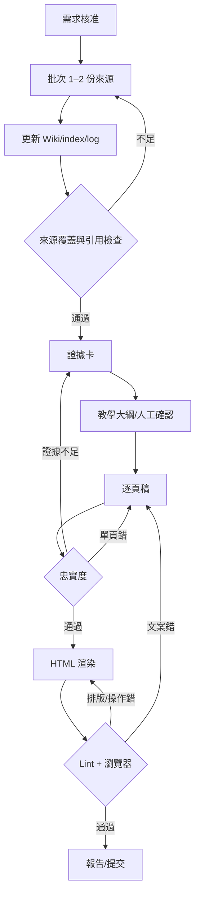

# /topic-slides｜HW10 工作節點與權限

本流程實作 `AGENTS.md`，不新增相互矛盾的主規格。

| 節點 | 允許讀取 | 允許寫入 | 禁止 |
|---|---|---|---|
| 來源核對 | 原始網址、raw/ | raw/、wiki/log.md | 虛構來源或把摘要稱為全文 |
| Wiki | raw/ | wiki/、index.md | 擅自增加來源未支持的結論 |
| 證據卡 | 單一 S# | cards/S#.md | 混用其他 S# |
| 大綱 | Wiki、證據卡 | outline.md | 假裝人工已核准 |
| 逐頁稿 | 大綱、證據卡 | drafts/slides.md | 自行加入數字或研究結論 |
| 忠實度檢查 | 逐頁稿與來源 | RUN_LOG.md | 未核對就標通過 |
| HTML 渲染 | 已通過的逐頁稿 | slides/index.html | 修改事實主張 |
| 靜態/瀏覽器檢查 | HTML、來源對照 | RUN_LOG.md、report.md | 把靜態檢查冒充瀏覽器實測 |

每個失敗回退路徑最多自動修正 **3 次**；仍失敗或證據不確定即停止請使用者確認。
