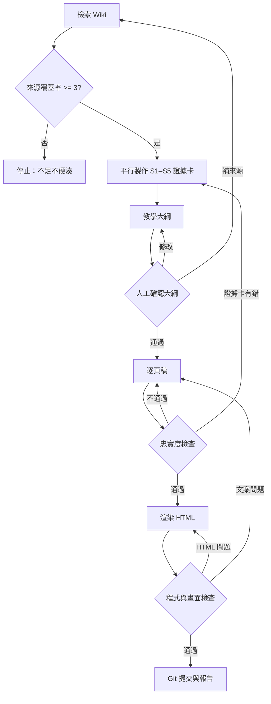

# /topic-slides — Graph Workflow Prototype

## 節點輸入輸出／權限
| 節點 | 只能讀 | 產出 | 不可做 |
|---|---|---|---|
| 檢索 | wiki/、raw/ | sources.md | 虛構外部來源 |
| 覆蓋率 | sources.md | 關卡判定 | 資料不足仍繼續 |
| 證據卡 | 單一來源 | cards/S*.md | 混用其他來源 |
| 大綱 | wiki/、cards/ | outline.md | 新增無證據的結論 |
| 人工確認 | outline.md | 確認狀態 | 假裝使用者已同意 |
| 逐頁稿 | outline.md、cards/ | drafts/slides.md | 超出證據卡內容 |
| 忠實度 | 草稿與來源 | report.md | 直接動手改稿 |
| HTML 渲染 | 已通過的草稿 | slides/index.html | 修改事實與數字 |
| 渲染檢查 | HTML 與草稿 | report.md | 不記錄失敗就宣稱通過 |

## 小圈與大圈
- 小圈：逐頁稿 → 忠實度 → 只修出錯頁；HTML → 渲染檢查 → 只修版面。
- 大圈：來源覆蓋不足或主題缺失才退回檢索，避免每次重跑全部。
- 最多 3 輪，超限停下請人工介入。
