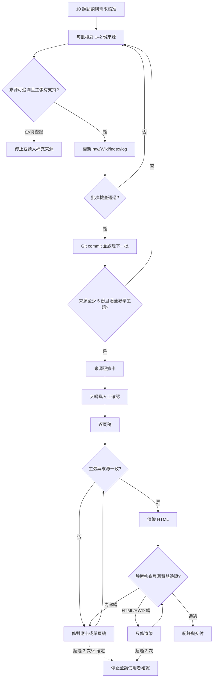

# HW10｜Graph 與有限次 Loop 設計

## 回退路徑與停止條件
| 失敗類型 | 退回節點 | 停止條件 |
|---|---|---|
| URL 不可達、資料不足 | 來源核對 | 無法取得可用來源，停止並記錄 |
| 主張缺證據、來源互相矛盾 | 證據卡或 Wiki | 3 次仍不一致，或無法判定就詢問 |
| 單頁內容錯誤 | 該頁逐頁稿 | 3 次仍不忠實就詢問 |
| HTML 按鈕/版面/RWD 失敗 | HTML 渲染 | 3 次仍失敗就詢問 |

**把檢查往前移：** 先做來源覆蓋與主張—證據比對，避免錯誤傳到 HTML；渲染後再驗證真正需要瀏覽器的互動和版面。自動 Lint 不取代人工內容核對。
