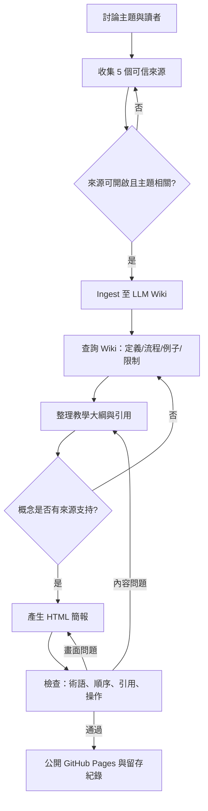

# Loop / Graph 設計

## 哪些地方會循環？
- **B → C → B**：資料不可讀或與主題不相關，換來源。
- **E → F → G → E**：無法在 Wiki 找到支持的段落，重新查詢或縮小主張。
- **H → I → H**：鍵盤操作、版面、文字溢出失敗時重新生成 HTML。
- **F → H → I → F**：簡報敘事順序有問題時，先改大綱再重新輸出，不只改 CSS。

## 提前檢查的原因
把「來源是否支持概念」放在產生 HTML **之前**，避免漂亮的投影片掩蓋不可靠敘述；把「可讀性與互動」放在 HTML 產出後，因為這部分必須實際開啟網頁才可驗證。

## 重要區分
本 repo 提供可讀的 Wiki 草稿與 HTML 成果。實際 LLM Wiki 平台 ingest 的執行結果，需要另附平台截圖；不得將「整理五篇來源」等同「平台成功 ingest 五篇」。
